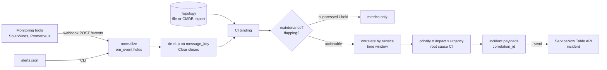

# snow-event-correlation

[](https://github.com/vagdevimsn-svg/snow-event-correlation/actions/workflows/ci.yml)
[](https://github.com/vagdevimsn-svg/snow-event-correlation/actions/workflows/quality.yml)


Turns a noisy stream of monitoring alerts into a few prioritized, service-aware **ServiceNow incidents**, following the ServiceNow Event Management / AIOps pipeline: normalize → de-duplicate → bind to CMDB CI → suppress maintenance and flapping noise → correlate by service → create one incident per real problem. Runs as a CLI or as a webhook service, and can create the incidents through the Table API without ever opening duplicates.

> **Portfolio project.** Independently written by Vagdevi Meka with synthetic alerts and topology. It contains no employer or client code or data and does not reproduce ServiceNow product code.

## Business problem

During an outage, monitoring tools fire dozens of alerts for one root cause: the database slows down, every app server behind it returns 5xx, a patched host goes "down" during its change window, and a service that restarts every few minutes pages someone each time. The service desk gets a ticket per alert and the real cause waits. Correlating alerts against CMDB relationships collapses that noise into one incident on the right service, with the probable-cause CI attached and priority driven by business impact.

**Sample run:** 16 raw alerts → 7 unique alerts → **3 incidents** (1 malformed event rejected, 1 alert suppressed by a maintenance window, 1 flapping alert held back) — **80% noise reduction**, with the payments outage raised as a single P1 against the database CI.

## Features

- **Normalization** of SolarWinds/Prometheus-style JSON to `em_event` fields with input validation
- **De-duplication** on `message_key` (source|node|type|resource); repeats increment count and escalate severity; Clear closes
- **CI binding** and an upward, cycle-safe dependency walk to the application service
- **Maintenance-window suppression**, inherited from parent CIs
- **Flap detection**: alerts re-opening N times within a window are held back instead of paging
- **Time-window correlation** per service; root cause = earliest highest-severity alert
- **Priority matrix**: impact (service tier from `busines_criticality`) × urgency (severity) → P1–P4
- **ServiceNow forwarder**: `POST /api/now/table/incident`, idempotent via `correlation_id`; dry-run unless `--send`
- **Webhook service**: `POST /events`, `GET /incidents`, `/metrics`, `/health`; optional bearer token
- **Topology from a CMDB export** — the same `cmdb_ci` + `cmdb_rel_ci` format as [snow-cmdb-data-quality](https://github.com/vagdevimsn-svg/snow-cmdb-data-quality)
- Zero runtime dependencies (stdlib only), packaged CLI, Dockerfile with healthcheck, 27 tests, ruff, coverage gate, Docker smoke test in CI

## Architecture



| This repo | ServiceNow equivalent |
|---|---|
| `normalize()` | Event field mapping / event rules |
| `message_key` de-dup | Alert de-duplication on `message_key` |
| `ci_by_host` | CI binding through CMDB identification |
| maintenance windows | Alerts suppressed for CIs in a change/maintenance window |
| flap detection | Flapping alert handling |
| service walk + time window | Service Mapping relationships + alert correlation rules / AIOps grouping |
| forwarder | Alert Management rule → incident, de-duplicated on `correlation_id` |

## Quick start

```bash
git clone https://github.com/vagdevimsn-svg/snow-event-correlation.git
cd snow-event-correlation
python -m venv .venv && source .venv/bin/activate
pip install -e ".[dev]"

event-corr --alerts sample_data/alerts.json --topology sample_data/topology.json            # incidents (dry-run)
event-corr --alerts sample_data/alerts.json --topology sample_data/topology.json --metrics  # noise metrics
event-corr --alerts sample_data/alerts.json --topology sample_data/cmdb_export.json         # topology from CMDB
event-corr --alerts sample_data/alerts.json --topology sample_data/topology.json \
           --maintenance sample_data/maintenance.json --window-min 15 --flap-threshold 3
```

Sample outputs: [incidents](docs/sample_output.json) · [metrics](docs/sample_metrics.json)

### Webhook service

```bash
EVENT_API_TOKEN=change-me event-corr-serve --topology sample_data/topology.json --port 8000
curl -X POST -H "Authorization: Bearer change-me" -H "Content-Type: application/json" \
     --data @sample_data/alerts.json http://127.0.0.1:8000/events
curl http://127.0.0.1:8000/incidents
curl http://127.0.0.1:8000/metrics
```

Docker: `docker build -t event-corr . && docker run -p 8000:8000 event-corr`

### Creating incidents on a personal developer instance (PDI)

```bash
cp .env.example .env          # instance URL + a user that can create incidents, or SN_TOKEN
set -a; source .env; set +a
event-corr --alerts sample_data/alerts.json --topology sample_data/topology.json --send
```

Each payload is checked by `correlation_id` before it is created, so running the same alerts twice reports `exists` instead of opening duplicates.

## Tests and quality

```bash
pytest -q --cov=event_corr     # 27 tests
ruff check .
```

Covers normalization and malformed input, de-duplication, Clear handling, cycle-safe service walks, window grouping, the priority matrix, maintenance suppression (including inheritance and expiry), flap detection, stable correlation IDs, CMDB-export topology, the CLI, the webhook service (auth, bad JSON, routes), and the forwarder end to end against a mock incident table (create, then skip duplicates, then auth failure). CI also builds the Docker image and smoke-tests the running service.

## Security

See [SECURITY.md](SECURITY.md): localhost bind by default, optional constant-time bearer token, 1 MB body limit, https enforced for the instance, credentials from environment variables only, synthetic data.

## Limitations and roadmap

- Correlation is rule-based (topology + time window), not ML-based; state is in memory.
- Next: persist alert state (SQLite), pull topology live from `cmdb_rel_ci`, send events to `em_event` instead of incidents, and Prometheus-format metrics.

## License

MIT — see [CHANGELOG.md](CHANGELOG.md) for release notes.
